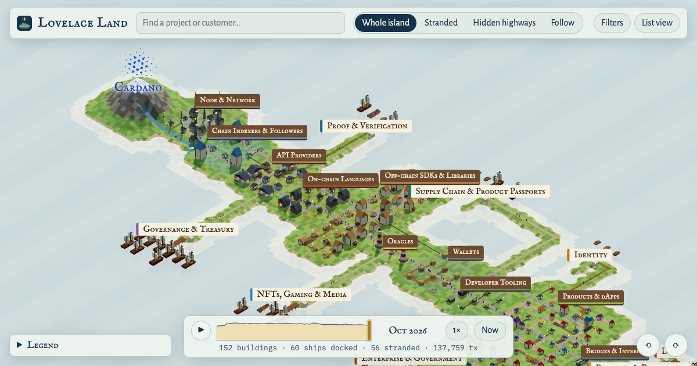

# Lovelace Land

**Who builds on whom in the Cardano ecosystem: an open, sourced map you can explore and replay month by month.**

→ **[Open the map](https://lovelace.land/)**



## The idea

Cardano is built in layers:
- end customers use products;
- products are built on SDKs, indexers and APIs;
- those sit on the node, the ledger and the network.

Most of these dependencies are invisible. Nobody sees which small library half the ecosystem quietly relies on, or which polished tool never reached a single real user.

Lovelace Land draws the ecosystem as an island, in the spirit of the old *Settlers* games:

| On the map | In the ecosystem |
|---|---|
| **Buildings** in districts | Projects: node, indexers, APIs, on-chain languages, SDKs, oracles, wallets, tooling, products, bridges |
| **Roads** | "Uses" relationships, each backed by a public source |
| **Ships** in harbors | Real customers and user groups, docked in the harbor of their sector (DeFi, Payments, Proof & Verification, Supply Chain, Identity, Governance, Exchanges & Custody, and more) |
| **The mountain** with the Cardano mark | The chain itself, where every road ultimately leads |
| **Settlers** walking the roads | Customer activity travelling from the ships through every dependency to the mountain |

As in Settlers, paths wear down with use. A road crossed by one pilot customer stays a muddy track. A road that carries the transactions of dozens of products turns into cobblestone.

## What it shows

- **Stranded buildings**: projects with no road to any active customer, for example a tool nobody ships to end users.
- **Hidden highways**: projects that carry a lot of traffic but are named directly by only a few others. These are the quiet central dependencies.
- **At risk**: projects that others still depend on, but whose repository hasn't had a commit in six months.
- **Follow**: click a ship to follow its goods down to the mountain, or click a building to trace it back to every ship that relies on it.
- **The timeline**: replay the ecosystem since smart contracts arrived in September 2021.
  - Ships sail away when their transactions stop, and return when they resume.
  - Idle projects burn after 4 months, fall into ruin after 6 and return to grass after 12.

## The data

Everything on the map comes from plain YAML files in [`data/`](data/), one per project or customer:

- **About 160 projects, 70 customers and 470 roads**, linked by more than 500 evidence links: manifests, `plutus.json` files, docs, case studies and announcements.
- **Every road has a confidence level:**
  - *verified*: a primary source, drawn as a solid road;
  - *reported*: a third-party source, drawn dashed;
  - *inferred*: a plausible but unconfirmed link, hidden unless you turn on "Show rumors".
- **Monthly on-chain transactions** for about 50 products and customers since 2021 (more than 26 million transactions), from the [Yaci Store](https://github.com/bloxbean/yaci-store) analytics service.
- **Monthly commit activity** for about 120 project repositories, from GitHub.
- **Kept up to date by weekly jobs**: they refresh the activity data, scan project manifests for new dependencies and check every source link.

The data is open under **CC BY 4.0**, so you're welcome to reuse it.

## Contributing

Spotted something wrong or missing? You don't need to write code:

- **[Report wrong data](../../issues/new?template=wrong-data.yml)** or **[report missing data](../../issues/new?template=missing-data.yml)**. Please include a public source.
- **Add a project, a road, a customer or on-chain identifiers yourself.** Most changes are a single YAML file.

**[CONTRIBUTING.md](CONTRIBUTING.md)** explains how: the file formats, what counts as evidence, how disputed data is decided, and how to add a new kind of data source.

## Run it locally

Requires Node.js 22.

```bash
npm ci
npm run build:world   # validate data/ and compute public/world.json
npm run dev           # open http://localhost:5173
```

| Command | What it does |
|---|---|
| `npm run check:data` | Validate the data and point at the exact file and field |
| `npm test` / `npm run e2e` | Unit tests / browser tests |
| `npm run collect:activity` | Refresh monthly transactions and commits |
| `npm run scan:manifests` | Find new dependencies in project manifests |
| `npm run check:links` | Check every source link |

The map is a static site, built with TypeScript, [Three.js](https://threejs.org) and Vite. It deploys to GitHub Pages on every push to `main`.

## License

Code is MIT licensed. The data in `data/` is CC BY 4.0: please credit "Lovelace Land contributors".
